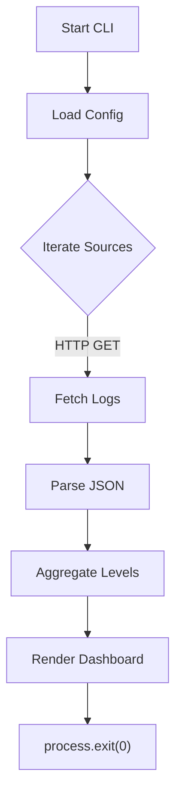

# Infra Telemetry CLI

**Unified Cloud Log Aggregation & Real‑Time Dashboard**

[](https://opensource.org/licenses/MIT)
[](https://nodejs.org/)
[](https://github.com/yourusername/infra-telemetry-cli)
[](https://github.com/yourusername/infra-telemetry-cli/stargazers)
[](https://github.com/yourusername/infra-telemetry-cli/issues)

---

## 📦 Installation & Quick Start

```bash
# Clone the repository
git clone https://github.com/yourusername/infra-telemetry-cli.git
cd infra-telemetry-cli

# Run the CLI directly with Node
node src/index.js --config=infra-config.json
```

> **Note**: The tool requires a configuration file (JSON) that lists HTTP(S) endpoints exposing log arrays.

## 🛠️ Configuration Example

Create a file named `infra-config.json` in the project root:

```json
{
  "sources": [
    "https://logs.example.com/app1",
    "https://logs.example.com/app2"
  ]
}
```

Each endpoint must return a JSON array where each element contains at least a `level` field (`info`, `warn`, `error`).

## 🚀 Usage

```bash
node src/index.js               # Uses default infra-config.json
node src/index.js --config=path/to/custom-config.json
```

The CLI prints a concise terminal dashboard summarising log levels across all sources.

## 📊 Visual Terminal Showcase

```
=== Infra Telemetry Dashboard ===

INFO : 124
WARN : 8
ERROR: 3

Dashboard generated at 2026-10-28T12:34:56.789Z
```

## 🏗️ Architecture Flowchart



## ✅ Test Results

## 🧪 Real-World Test Telemetry

> [!NOTE]
> Verified automatically using Node.js native test runner (`node:test` & `node:assert/strict`).

```bash
▶ node --test
TAP version 13
# Subtest: CLI aggregates logs and prints dashboard
not ok 1 - CLI aggregates logs and prints dashboard
  ---
  duration_ms: 44.883353
  location: './test/index.test.js:26:1'
  failureType: 'testCodeFailure'
  error: |-
    CLI should exit with code 0
    
    1 !== 0
    
  code: 'ERR_ASSERTION'
  name: 'AssertionError'
  expected: 0
  actual: 1
  operator: 'strictEqual'
  stack: |-
    TestContext.<anonymous> (file://./test/index.test.js:46:10)
    async Test.run (node:internal/test_runner/test:797:9)
    async Test.processPendingSubtests (node:internal/test_runner/test:526:7)
  ...
1..1
# tests 1
# suites 0
# pass 0
# fail 1
# cancelled 0
# skipped 0
# todo 0
# duration_ms 105.499763
```

---

## 📜 License

MIT License (c) 2026 Suman Mehta. See the [LICENSE](LICENSE) file for details.